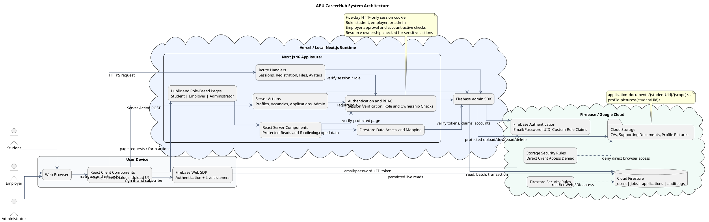
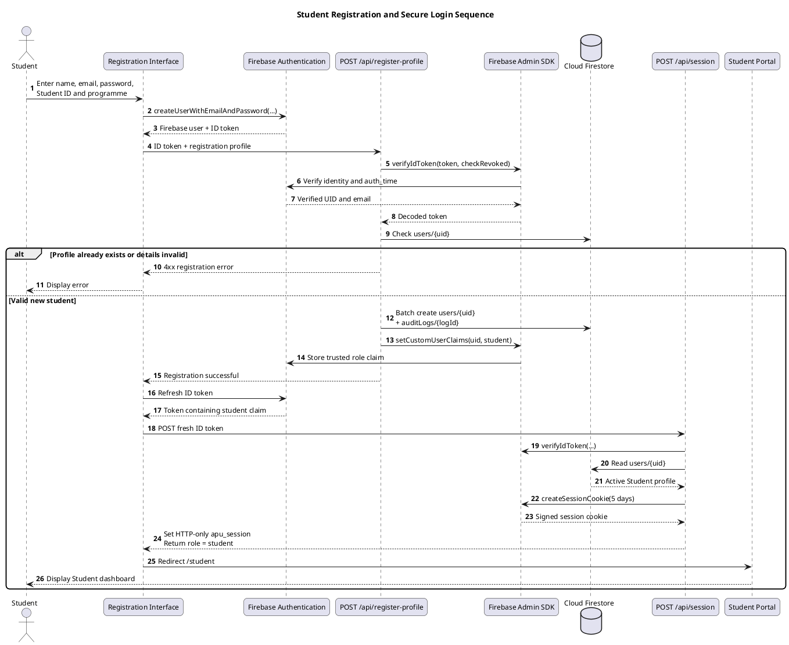
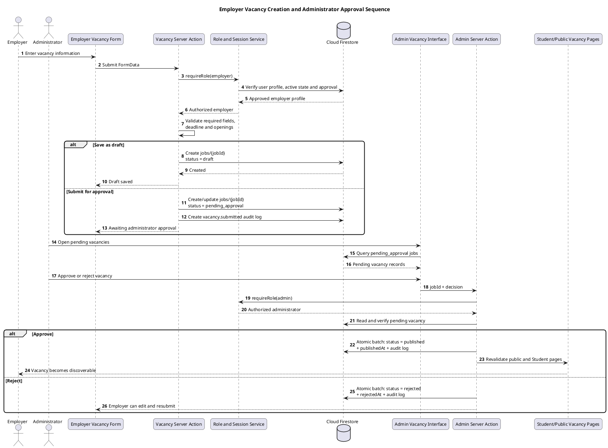
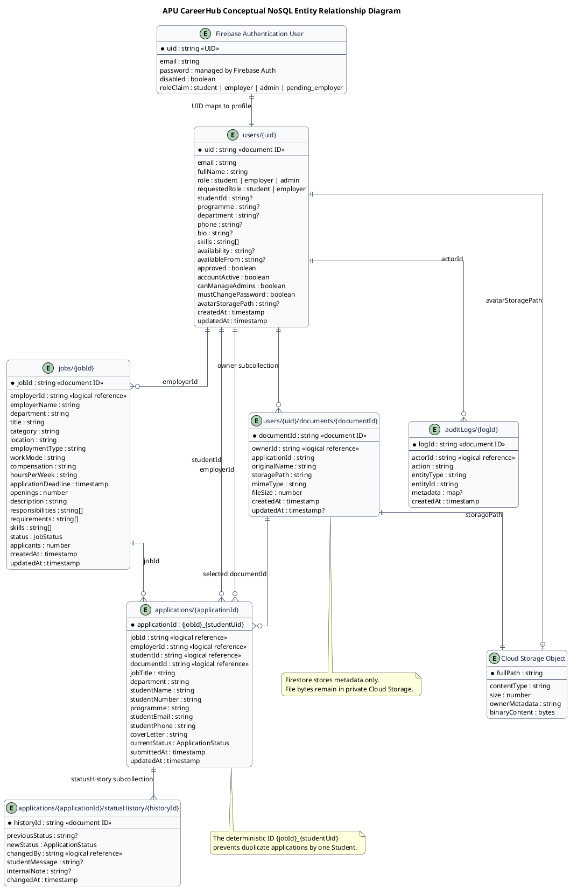

# APU CareerHub Architecture, Sequence Diagrams and Database Design

**Purpose:** This document recreates the architecture, sequence-diagram and database-design coverage found in the supplied AfterClass sample, but uses only features and technologies verified in the APU CareerHub source code.

**System:** APU CareerHub — APU On-Campus Employment Portal  
**Verification basis:** Next.js routes, React components, Server Actions, Route Handlers, shared types, Firebase initialization, Firestore access code, Firestore rules, Storage rules and project dependencies inspected on 2 September 2026.

> **Suggested report numbering:** The existing report already uses **4.2.1 Use Case Diagram**. Therefore, the most suitable continuation is **4.2.2 System Architecture Diagram**, **4.2.3 Sequence Diagrams**, and **4.3 Database Design**. Adjust the numbers if the report has since changed.

---

## 1. Coverage of the supplied sample

The supplied sample contains the following design material:

1. A theoretical explanation of system architecture diagrams.
2. A project-specific system architecture description.
3. A theoretical explanation of sequence diagrams.
4. Two project-specific sequence diagrams.
5. A database-architecture explanation.
6. An Entity Relationship Diagram (ERD) and entity descriptions.

The same categories are provided below for APU CareerHub. The content is not copied from AfterClass because the two systems use different technologies, actors, data models and workflows.

---

# 4.2.2 System Architecture Diagram

A system architecture diagram presents the technical structure of a software system by showing its users, interface layer, application services, data stores, external services and the connections between them. Architecture descriptions are important because they communicate the system's major elements, relationships and stakeholder concerns through a consistent technical view (ISO/IEC/IEEE, 2022). For APU CareerHub, the architecture diagram is used to explain how students, employers and administrators interact with the web interface and how requests are processed through Next.js and Firebase services.

APU CareerHub follows a full-stack web architecture based on **Next.js 16.3.0**, **React 19.2.8** and **TypeScript 5**. The browser displays public pages and separate role-based portals for students, employers and administrators. The application uses a mixture of React Server Components and Client Components. Server Components load protected data directly for page rendering, while Client Components manage interactive forms, filters, dialogs, upload controls, Firebase Authentication and live Firestore listeners. This division follows the Next.js App Router model, in which server-rendered components, Route Handlers and Server Actions may be combined inside one application (Vercel, 2026a).

The application-processing layer is implemented through **Next.js Server Actions** and **Route Handlers**. Server Actions process profile changes, vacancy creation, vacancy approval, application submission, application-status changes and administrative account operations. Route Handlers process secure session creation, registration profiles, document uploads and downloads, document renaming and deletion, and student profile-picture operations. Server-side mutations are appropriate for this design because they allow forms to invoke protected server logic and return updated data or interface state through the Next.js application (Vercel, 2026b).

The server uses the **Firebase Admin SDK** as its trusted connection to Firebase Authentication, Cloud Firestore and Cloud Storage. Firebase Authentication manages email-and-password identities, custom role claims, password changes and disabled accounts. A fresh Firebase ID token is exchanged for a five-day HTTP-only session cookie after the server verifies the token, the user's Firestore profile, the active-account flag and the trusted role claim. Firebase documents that server-side session cookies retain the claims of the verified ID token and may be configured with `httpOnly`, `secure`, path and expiry settings (Google, 2026a).

**Cloud Firestore** stores the operational and audit data of the portal. Its main collections are `users`, `jobs`, `applications` and `auditLogs`. Student document metadata is stored in a `documents` subcollection under the corresponding user, while each application stores its ordered status records in a `statusHistory` subcollection. Firestore is a document-oriented NoSQL database in which documents are organized into collections and may contain nested objects or subcollections (Google, 2026b).

**Firebase Cloud Storage** stores the actual student CVs, supporting documents and optional student profile pictures. Application documents use owner-scoped paths beginning with `application-documents/{studentUid}/`, while student pictures use `profile-pictures/{studentUid}/`. Direct browser access to Cloud Storage is denied by the project's Storage rules. Instead, protected Next.js Route Handlers verify the current role, ownership, application relationship, file type, file signature, file size and safe storage path before reading or writing a file. This design prevents users from bypassing the application's authorization and retention checks.

The system also uses the Firebase Web SDK in the browser for email-and-password authentication and read-only Firestore snapshot listeners. The live-update component listens to role-appropriate `users`, `jobs` and `applications` queries and requests a router refresh after relevant changes. The main business writes remain server-mediated so that role, ownership and workflow checks are repeated inside trusted code.

The architecture therefore separates the portal into the following layers:

1. **User layer** — Student, Employer and Administrator.
2. **Presentation layer** — responsive React interfaces, public pages and role dashboards.
3. **Application layer** — Next.js Server Components, Client Components, Server Actions and Route Handlers.
4. **Security layer** — Firebase Authentication, custom claims, HTTP-only sessions, role checks, ownership checks and Firebase Security Rules.
5. **Data layer** — Cloud Firestore collections, documents, subcollections and indexes.
6. **File-storage layer** — private Cloud Storage objects for submitted documents and profile pictures.
7. **Deployment layer** — the Next.js application is designed to run locally during development and on Vercel for deployment.

The architecture diagram is useful because it shows that APU CareerHub is not implemented with a separate Express server, relational database or local file-storage directory. Instead, Next.js provides the full-stack web application, and Firebase provides identity, database and file-storage services. The diagram also makes the security boundary clear: the browser performs authentication and permitted live reads, but protected data changes and private file access are authorized through the server.

**[Insert the APU CareerHub system architecture diagram here]**

*Figure 4.X: APU CareerHub System Architecture Diagram*

## PlantUML code — system architecture diagram



## Architecture component mapping

| Architecture component | CareerHub implementation | Main responsibility |
|---|---|---|
| Users | Student, Employer and Administrator | Perform the three role journeys supported by the portal. |
| Browser interface | React, Next.js pages, Tailwind CSS and shadcn/Base UI components | Display public pages, dashboards, forms, lists, status information and administrative controls. |
| Next.js Server Components | Files under `src/app/**/page.tsx` and role layouts | Verify protected pages, load server-side data and render role-specific content. |
| Client Components | Components such as authentication, vacancy, application, document and live-update controls | Handle interactive interface state, browser authentication, filtering and file selection. |
| Server Actions | `src/app/actions/*.ts` | Perform trusted mutations for profiles, vacancies, applications and administration. |
| Route Handlers | `src/app/api/**/route.ts` | Create sessions and registration profiles and mediate protected file/profile-picture operations. |
| Authentication service | Firebase Authentication | Store credentials, issue tokens, assign custom role claims, change passwords and disable accounts. |
| Session control | `src/app/api/session/route.ts` and `src/lib/auth/server.ts` | Create and verify the `apu_session` HTTP-only cookie and enforce role access. |
| Operational database | Cloud Firestore | Store user profiles, vacancy records, applications, status histories, document metadata and audit logs. |
| File storage | Firebase Cloud Storage | Store the bytes of private CVs, supporting documents and profile pictures. |
| Live update mechanism | Firebase Web SDK `onSnapshot` listeners | Detect changes to role-relevant data and request refreshed Next.js content. |
| Security rules | `firestore.rules` and `storage.rules` | Restrict direct client operations and deny direct Cloud Storage access. |
| Deployment | Local Node.js/Next.js runtime and intended Vercel deployment | Run the full-stack application. |

---

# 4.2.3 Sequence Diagrams

A sequence diagram models the dynamic behaviour of a system by arranging interactions in chronological order. It identifies which actor or component starts an action, which messages are exchanged, which validation decisions are performed and where information is read or stored. Sequence diagrams are suitable for APU CareerHub because its main functions involve several coordinated components: the browser interface, Firebase Authentication, the Next.js server, Cloud Firestore and Cloud Storage.

The supplied sample contains two sequence diagrams for its most important AI and group-management processes. Those processes do not exist in APU CareerHub. For CareerHub, the sequence diagrams should instead represent the recruitment workflows promised by the project objectives: controlled access, vacancy publication, secure online applications and application-status tracking.

## 4.2.3.1 Student Registration and Secure Login Sequence

The student registration and login sequence begins when a new user completes the Student registration form. Firebase Authentication creates the email-and-password identity and returns a fresh ID token. The browser sends this token together with the student's full name, Student ID and programme to the registration Route Handler. The server verifies the token and checks that the profile does not already exist. It then creates the Firestore user profile and registration audit entry as a batch and assigns the trusted `student` custom claim.

The browser subsequently obtains the refreshed ID token and sends it to the session Route Handler. The server verifies that the authentication is recent, confirms that the Firestore profile is active and checks that the role claim matches the stored profile. A five-day HTTP-only `apu_session` cookie is then created and the student is redirected to the Student portal. The same login process is used for employers and administrators, but an employer account is blocked while its claim is `pending_employer` or its Firestore profile remains unapproved.

**[Insert the student registration and secure-login sequence diagram here]**

*Figure 4.X: Student Registration and Secure Login Sequence Diagram*



## 4.2.3.2 Employer Vacancy Creation and Administrator Approval Sequence

The vacancy workflow begins after an employer account has been approved. The employer opens the vacancy form and provides the job title, category, employment type, location, work arrangement, compensation, expected hours, deadline, number of openings, description, responsibilities, requirements and useful skills. The Server Action verifies the employer session and approval state before validating the form.

An incomplete vacancy may be saved as a draft. A complete vacancy submitted for publication is stored with the status `pending_approval`, meaning it is not visible in Student vacancy results. The administrator views the pending record and may approve or reject it. Approval changes the status to `published` and adds a publication timestamp; rejection changes it to `rejected`, allowing the employer to edit and resubmit the record. Each decision creates an audit-log document, and the affected Next.js pages are revalidated. Only published vacancies are returned by Student and public job queries.

**[Insert the vacancy creation and approval sequence diagram here]**

*Figure 4.X: Employer Vacancy Creation and Administrator Approval Sequence Diagram*



## 4.2.3.3 Secure Document Upload and Application Submission Sequence

Before submitting an application, a student uploads a CV or supporting document. The document Route Handler first verifies the Student role, the file's supported MIME type and the five-megabyte size limit. It creates an owner-scoped Cloud Storage path and uploads the file. The server then stores the corresponding metadata in the student's Firestore `documents` subcollection and creates an audit record. If the metadata batch fails after the file upload, the uploaded object is deleted as a rollback measure.

When the Student submits an application, the application Server Action checks the Student role, cover-letter length, selected document identifier, vacancy existence, publication state and application deadline. It also prevents a duplicate application by using a deterministic application identifier formed from the job ID and Student UID. The selected document must exist under the Student's own subcollection and its storage path must begin with that Student's protected path.

After all checks succeed, a Firestore batch creates the application, creates its first `statusHistory` entry, creates an audit log and increments the vacancy's applicant counter. Firestore batched writes are atomic, meaning either every operation is applied or none of them is applied (Google, 2026c). This prevents an application record from being created without its initial status and associated vacancy count.

**[Insert the secure document upload and application submission sequence diagram here]**

*Figure 4.X: Secure Document Upload and Student Application Submission Sequence Diagram*

```plantuml
@startuml
title Secure Document Upload and Student Application Submission Sequence

autonumber
skinparam backgroundColor #FFFFFF
skinparam shadowing false
skinparam roundCorner 12
skinparam defaultFontName Arial
skinparam defaultFontSize 12

actor Student
participant "Student Document Interface" as DocumentsUI
participant "Document Upload Route" as UploadAPI
participant "Role and Session Service" as RBAC
folder "Cloud Storage" as Storage
database "Cloud Firestore" as DB
participant "Application Form" as ApplicationUI
participant "Application Server Action" as ApplicationAction
participant "Success / Tracking Page" as ResultUI

Student -> DocumentsUI : Select PDF, DOC or DOCX
DocumentsUI -> UploadAPI : Multipart file upload
UploadAPI -> RBAC : requireRole(student)
RBAC --> UploadAPI : Authorized Student UID
UploadAPI -> UploadAPI : Validate MIME type, size,\ndestination and safe filename
UploadAPI -> Storage : Save to application-documents/{uid}/...
Storage --> UploadAPI : File stored
UploadAPI -> DB : Batch create document metadata\n+ document.uploaded audit log

alt Firestore metadata batch fails
  UploadAPI -> Storage : Delete uploaded object (rollback)
  UploadAPI --> DocumentsUI : Upload failed
else Upload succeeds
  UploadAPI --> DocumentsUI : Return document ID
end

Student -> ApplicationUI : Enter cover letter, choose document, confirm
ApplicationUI -> ApplicationAction : Submit FormData
ApplicationAction -> RBAC : requireRole(student)
RBAC --> ApplicationAction : Authorized Student UID
ApplicationAction -> DB : Read jobs/{jobId}
DB --> ApplicationAction : Vacancy status and deadline
ApplicationAction -> DB : Check applications/{jobId_uid}
ApplicationAction -> DB : Read users/{uid}\n+ users/{uid}/documents/{documentId}
ApplicationAction -> ApplicationAction : Verify publication, deadline,\nduplicate and document ownership

alt Any validation fails
  ApplicationAction --> ApplicationUI : Return clear error
else All validation succeeds
  ApplicationAction -> DB : Atomic batch:\ncreate application\ncreate first statusHistory\ncreate audit log\nincrement job applicants
  DB --> ApplicationAction : Batch committed
  ApplicationAction --> ResultUI : Application submitted
  ResultUI --> Student : Show success and tracking link
end

@enduml
```

## 4.2.3.4 Employer Review and Student Status Tracking Sequence

The employer can view only applications whose `employerId` matches the employer's authenticated UID. On the applicant-details page, the employer can review the Student's submitted profile information, cover letter and selected document. The download Route Handler permits access only when the employer owns the related application and the requested document is the same document referenced by that application.

The employer updates the application through a controlled transition map. An application may move from `submitted` to `under_review` or `rejected`, from `under_review` to `shortlisted` or `rejected`, from `shortlisted` to `interview` or `rejected`, and from `interview` to `offered` or `rejected`. Terminal states cannot be moved again. A valid update atomically changes the application's current status, creates a status-history entry and creates an audit-log entry. The optional `studentMessage` is displayed in the Student's status timeline, while `internalNote` is stored for authorized review purposes.

The Student application page reads the current application and its ordered `statusHistory` subcollection. Revalidation makes the updated information available after the mutation, while role-level snapshot listeners are intended to request a router refresh when application records change. Current testing should still verify automatic detail-page refresh separately because one earlier test observed that the detail page did not always update until a manual refresh.

**[Insert the employer review and status-tracking sequence diagram here]**

*Figure 4.X: Employer Application Review and Student Status Tracking Sequence Diagram*

```plantuml
@startuml
title Employer Review and Student Status Tracking Sequence

autonumber
skinparam backgroundColor #FFFFFF
skinparam shadowing false
skinparam roundCorner 12
skinparam defaultFontName Arial
skinparam defaultFontSize 12

actor Employer
actor Student
participant "Employer Application Page" as EmployerUI
participant "Protected Download Route" as DownloadAPI
participant "Application Status Server Action" as StatusAction
participant "Role and Session Service" as RBAC
database "Cloud Firestore" as DB
folder "Cloud Storage" as Storage
participant "Student Application Timeline" as StudentUI

Employer -> EmployerUI : Open application details
EmployerUI -> RBAC : Verify Employer session
RBAC -> DB : Check application.employerId
DB --> EmployerUI : Applicant profile, cover letter and status

Employer -> EmployerUI : Download selected CV
EmployerUI -> DownloadAPI : ownerId + documentId + applicationId
DownloadAPI -> RBAC : requireRole(employer)
DownloadAPI -> DB : Verify application belongs to employer\n+ and document belongs to Student
DB --> DownloadAPI : Authorized metadata
DownloadAPI -> Storage : Download protected object
Storage --> DownloadAPI : File bytes
DownloadAPI --> EmployerUI : Private, no-store attachment

Employer -> EmployerUI : Choose next status and enter message
EmployerUI -> StatusAction : applicationId, status, message, note
StatusAction -> RBAC : requireRole(employer or admin)
StatusAction -> DB : Read application
StatusAction -> StatusAction : Verify ownership and\nallowed status transition

alt Invalid owner or transition
  StatusAction --> EmployerUI : Return error
else Valid status transition
  StatusAction -> DB : Atomic batch:\nupdate currentStatus\ncreate statusHistory\ncreate audit log
  StatusAction --> EmployerUI : Decision saved
  StatusAction -> StudentUI : Revalidate Student pages
end

Student -> StudentUI : Open application progress
StudentUI -> DB : Read application + ordered statusHistory
DB --> StudentUI : Current status and Student messages
StudentUI --> Student : Display progress timeline

@enduml
```

## Workflow state models

### Vacancy status lifecycle

```text
Draft
  └── Submit ──> Pending approval
                    ├── Approve ──> Published ──> Closed ──> Archived
                    └── Reject  ──> Rejected ──> Edit and resubmit

Eligible non-pending records may also be archived by an Administrator.
```

### Application status lifecycle

```text
Submitted
  ├── Rejected
  └── Under review
        ├── Rejected
        └── Shortlisted
              ├── Rejected
              └── Interview
                    ├── Rejected
                    └── Offered
```

> The `withdrawn` status exists in the shared type and Firestore rule model, but the current Student interface does not provide a completed withdrawal action. It should not be presented as a fully implemented user journey unless that interface is added and tested.

---

# 4.3 Database Design

## 4.3.1 Firebase Data Architecture

APU CareerHub uses a Firebase-based data architecture consisting of **Cloud Firestore**, **Firebase Authentication** and **Firebase Cloud Storage**. These services have separate responsibilities but are connected through the Firebase UID and the identifiers stored in Firestore documents.

Cloud Firestore is the main operational database of APU CareerHub. Unlike a relational database, Firestore does not store data in tables with enforced foreign keys. It stores key-value documents inside collections and supports hierarchical subcollections (Google, 2026b). The main collections in CareerHub are `users`, `jobs`, `applications` and `auditLogs`. The application code maintains consistent fields and logical identifier references even though Firestore itself is schemaless.

Firebase Authentication is the source of login identities. Each Authentication account has a UID, and the matching Firestore user profile is stored at `users/{uid}`. Passwords are handled only by Firebase Authentication and are not stored in Firestore. Trusted custom claims identify a user as `student`, `employer` or `admin`. A self-registered employer initially receives the non-privileged `pending_employer` claim and cannot enter the Employer portal until an Administrator approves the account.

Cloud Storage stores binary files rather than operational records. A student document's Firestore metadata contains its owner, original name, content type, size and protected Storage path. The actual bytes are stored separately in Cloud Storage. Student profile pictures use the same separation: the `users` profile stores the Storage path and content type, while the image bytes remain inside a private object.

The project uses subcollections for records that naturally belong to a parent document:

- `users/{studentUid}/documents/{documentId}` stores the Student's document metadata.
- `applications/{applicationId}/statusHistory/{historyId}` stores the ordered history of application decisions.

This design keeps Student document metadata under its owner and status events under the corresponding application. It also supports queries for top-level operational records, such as all applications belonging to one student or all vacancies belonging to one employer.

Firestore composite indexes support the portal's main query patterns, including published vacancies by deadline, Employer vacancies by creation date, Student applications by submission date, and Employer applications by submission date and status. Important multi-record changes are performed through batched writes or transactions. For example, application submission creates the application, status history and audit event while incrementing the vacancy applicant count as one atomic batch.

The database is protected by both application logic and Firebase Security Rules. Firestore rules allow published jobs to be read publicly and restrict private users, applications, documents and audit data according to role and ownership. Direct mutations of document metadata are denied because the server must coordinate metadata and Storage objects. Cloud Storage rules deny every direct client read and write, and protected server routes perform authorization before using the Firebase Admin SDK. Firebase explains that Storage Security Rules can control access by path, identity, metadata, content type and file size; CareerHub uses an even stricter model by closing direct client Storage access entirely (Google, 2026d).

**[Insert a screenshot of the Firestore collections and Cloud Storage folders here]**

*Figure 4.X: Firebase Data Architecture of APU CareerHub*

## 4.3.2 Main Firestore Collections and Subcollections

| Collection or path | Document identifier | Purpose | Important fields |
|---|---|---|---|
| `users/{uid}` | Firebase Authentication UID | Stores Student, Employer or Administrator profile and access information. | `email`, `fullName`, `role`, `requestedRole`, `studentId`, `programme`, `department`, `phone`, `bio`, `skills`, `availability`, `availableFrom`, `approved`, `accountActive`, `canManageAdmins`, `mustChangePassword`, avatar fields, timestamps. |
| `users/{uid}/documents/{documentId}` | Generated UUID | Stores metadata for a Student-owned CV or supporting document. | `ownerId`, `applicationId`, `originalName`, `storagePath`, `mimeType`, `contentType`, `fileSize`, `size`, `uploadedAt`, `createdAt`, `updatedAt`. |
| `jobs/{jobId}` | Firestore-generated ID | Stores vacancy information and its approval/publication state. | `title`, `description`, `category`, `location`, `employmentType`, `workMode`, `compensation`, `hoursPerWeek`, `applicationDeadline`, `openings`, `responsibilities`, `requirements`, `skills`, `department`, `employerId`, `employerName`, `status`, `applicants`, timestamps and decision fields. |
| `applications/{applicationId}` | Deterministic `{jobId}_{studentUid}` | Stores one Student application for one vacancy and prevents duplicates. | `jobId`, `jobTitle`, `department`, `employerId`, `studentId`, `studentName`, `studentNumber`, `programme`, `studentEmail`, `studentPhone`, `coverLetter`, `documentId`, `currentStatus`, `submittedAt`, `updatedAt`. |
| `applications/{applicationId}/statusHistory/{historyId}` | Firestore-generated ID | Stores the immutable sequence of application-status changes. | `previousStatus`, `newStatus`, `changedBy`, `studentMessage`, `internalNote`, `changedAt`. |
| `auditLogs/{logId}` | Firestore-generated ID | Records important authentication, profile, document, vacancy, application and administrative events. | `actorId`, `action`, `entityType`, `entityId`, `metadata`, `createdAt`. |

## 4.3.3 Cloud Storage Paths

| Storage path pattern | Stored content | Main authorization rule in server code |
|---|---|---|
| `application-documents/{studentUid}/profile/{documentId}-{safeName}` | Reusable CV or supporting document uploaded through the Student document page. | Only the authenticated Student owner may upload, rename or delete; related Employers may download only the document selected for their application; Administrators may download for oversight. |
| `application-documents/{studentUid}/{applicationId}/{documentId}-{safeName}` | Application-scoped supporting file when that upload mode is used. | The application must exist and belong to the Student before upload. |
| `profile-pictures/{studentUid}/{uuid}.{extension}` | Optional JPG, PNG or WebP Student picture. | Owner Student may upload/delete; related Employer may view through an owned application; Administrator may view. |

## 4.3.4 Logical Relationships

Because Cloud Firestore is NoSQL, these relationships are maintained through document IDs and server-side validation rather than database-enforced foreign-key constraints.

| Relationship | Cardinality | Implementation |
|---|---:|---|
| Firebase Authentication account to Firestore user profile | 1:1 | Authentication UID is used as `users/{uid}`. |
| Employer user to jobs | 1:M | Each job stores `employerId`; Employer queries filter by the authenticated UID. |
| Student user to applications | 1:M | Each application stores `studentId`; Student queries filter by the authenticated UID. |
| Employer user to applications | 1:M | Each application stores `employerId`; Employer review is limited to matching records. |
| Job to applications | 1:M | Each application stores `jobId`; application submission also increments `jobs.applicants`. |
| Student user to document metadata | 1:M | Documents are stored below `users/{uid}/documents`. |
| Stored document to applications | 1:M logically | An application stores the selected `documentId`; the same owned profile document may be selected for more than one application. |
| Application to status-history records | 1:M | Status entries are stored below `applications/{applicationId}/statusHistory`. |
| User to audit-log events | 1:M | Audit records store `actorId`. |
| Firestore document metadata to Cloud Storage object | 1:1 | Document metadata stores one protected `storagePath`. |
| User profile to profile-picture Storage object | 0:1 | Optional avatar fields store one protected profile-picture path. |

## 4.3.5 Entity Relationship Diagram

The APU CareerHub ERD is a **conceptual NoSQL ERD**. It displays the Firestore collections, subcollections, logical reference fields and Firebase services as entities. The diagram should not claim that Firestore enforces SQL primary-key and foreign-key constraints. The application enforces these relationships through IDs, role checks, ownership checks, deterministic application IDs, Firestore batches and Security Rules.

The `AUTH_USER` entity represents the Firebase Authentication identity. Its UID maps to the `USER_PROFILE` document. Employer profiles create vacancy records, while Student profiles create application records and own document metadata. A vacancy can receive many applications, but the deterministic application ID prevents one Student from applying to the same vacancy more than once. Each application has multiple status-history entries. Audit-log records may describe changes to users, vacancies, applications or documents.

The `STORED_DOCUMENT` entity contains metadata rather than the actual file. Its `storagePath` points to a private Cloud Storage object. A submitted application references the selected document by `documentId`. Documents attached to submitted applications cannot be deleted because they form part of the application record. Similarly, a profile picture is stored in Cloud Storage and referenced by optional fields in the Student's user profile.

**[Insert the APU CareerHub Entity Relationship Diagram here]**

*Figure 4.X: Entity Relationship Diagram for APU CareerHub*



## Entity explanations

### User Profile

The User Profile document stores portal information for all three roles. Shared fields include email, full name, role, phone number, approval status and account-active status. Student-specific fields include Student ID, programme, biography, skills and availability. Employer-specific fields include the department and department description. Administrator-specific control fields include `canManageAdmins` and `mustChangePassword`. The UID of the matching Firebase Authentication account is used as the Firestore document identifier.

### Job

The Job document stores the full vacancy specification and the Employer who owns it. It contains descriptive fields, work conditions, application deadline, skill and requirement lists, the number of openings and the current vacancy status. The status controls whether the record is editable, awaiting approval, visible to students, rejected, closed or archived.

### Application

The Application document stores a snapshot of the Student and vacancy information required during recruitment review. It includes the cover letter, selected document identifier, employer identifier, Student identifier and current status. Its deterministic document identifier combines the vacancy ID and Student UID, ensuring that the same Student cannot create a second application for the same vacancy.

### Stored Document

The Stored Document subcollection document stores metadata for a Student-owned CV or supporting document. The actual file is not placed in Firestore. The metadata links to a protected Cloud Storage path and records the original filename, content type, file size, owner and upload time. Ownership and application references are checked before every protected download or deletion.

### Status History

Each Status History document records one transition in the application process. It identifies the previous and new status, the user who made the change, a Student-visible message, an optional internal note and the time of the change. These documents allow the Student timeline to show a chronological recruitment history instead of only the latest state.

### Audit Log

The Audit Log collection records important operations such as registration, sign-in, sign-out, profile changes, document operations, vacancy decisions, application submission, application-status changes, Employer approval and account activation or deactivation. Administrators can review the latest audit events through the portal. Audit records support accountability, but they are application-level audit records rather than a replacement for infrastructure-level security logging.

---

# 5. Differences Between the AfterClass Sample and APU CareerHub

The following items appear in the supplied sample but are **not implemented in APU CareerHub**. They must not be copied into the CareerHub report as if they were part of the system.

| Feature or technology in the sample | Present in APU CareerHub? | Correct CareerHub position |
|---|:---:|---|
| React + Vite frontend | No | CareerHub uses React through Next.js 16 App Router, not Vite. |
| FastAPI backend | No | CareerHub uses Next.js Server Actions and Route Handlers. |
| Python backend | No | CareerHub's frontend and server code are written in TypeScript. |
| Supabase PostgreSQL | No | CareerHub uses Firebase Cloud Firestore. |
| SQLAlchemy ORM | No | Firestore is accessed through Firebase Admin/Web SDKs; no ORM is used. |
| Alembic migrations | No | Firestore has no SQL schema migrations; rules and indexes are version-controlled instead. |
| ChromaDB vector database | No | CareerHub has no vector database. |
| OpenRouter or another LLM API | No | CareerHub has no generative-AI or LLM integration. |
| Retrieval-Augmented Generation (RAG) | No | Uploaded CVs are stored securely; they are not chunked, embedded or queried by AI. |
| AI task workflow generation | No | CareerHub manages recruitment vacancies and applications, not academic task generation. |
| PDF rubric extraction or assignment analysis | No | CareerHub validates and stores application documents but does not extract their academic content. |
| Local machine-learning model files | No | CareerHub has no risk/trust prediction models. |
| Group creation, join codes and group membership | No | CareerHub uses individual Student, Employer and Administrator accounts. |
| Group chat | No | CareerHub does not provide chat between students and employers. |
| Lecturer role and lecturer monitoring | No | CareerHub's third role is Administrator; there is no Lecturer role. |
| Peer evaluation | No | CareerHub does not evaluate group members. |
| Trust score and group-risk analytics | No | CareerHub does not calculate behavioural trust or risk scores. |
| Local upload storage | No | Files are stored in Firebase Cloud Storage. |
| Hybrid relational/vector database architecture | No | CareerHub uses Firestore for records and Cloud Storage for files; this is a service separation, not relational/vector hybrid storage. |
| Relational primary and foreign keys | No | CareerHub uses Firestore document IDs and logical reference fields validated by server code. |

## CareerHub features that should replace the sample-only material

The CareerHub chapter should emphasize the following implemented workflows instead:

- Student registration and secure role-based sessions.
- Pending Employer access and Administrator approval.
- Employer vacancy drafting, validation and submission.
- Administrator vacancy approval or rejection.
- Public and Student discovery of published vacancies.
- Private Student CV/supporting-document management.
- Student online application submission and duplicate prevention.
- Employer applicant review and protected document access.
- Controlled application-status transitions and Student progress tracking.
- Administrator user access, vacancy oversight, application monitoring and audit records.

---

# 6. Verified Current Limitations and Important Reporting Notes

These items are based on the current code and earlier testing. They should be treated carefully in the final report.

1. **No artificial intelligence features:** CareerHub has no LLM, RAG, recommendation model, CV parser or machine-learning analytics. The Student recommendations are interface/data matching, not AI.
2. **No relational database:** Do not describe Firestore collections as SQL tables or claim that foreign keys are enforced by the database.
3. **No separate Express backend:** Next.js is both the frontend framework and server runtime for this project.
4. **No internal support-ticket workflow:** Support pages open an external Gmail compose link. The source code does not create or manage a `supportRequests` record.
5. **No automatic email notification service:** Notifications shown in the interface are derived from current Firestore records; the project does not send recruitment email notifications.
6. **Student withdrawal is incomplete:** `withdrawn` exists in the type/rule model, but there is no completed Student withdrawal control in the current interface.
7. **Private review notes are not surfaced in a dedicated history interface:** `internalNote` is stored with a status-history record, but the current pages do not provide a complete interface for viewing previously saved private notes.
8. **Administrator application detail is limited:** The Administrator can monitor and filter applications system-wide. The status-update Server Action accepts Administrators, but the current Admin interface does not provide the same full application-detail decision page used by Employers.
9. **Automatic detail-page refresh must be described cautiously:** The system contains Firestore snapshot listeners and page revalidation, but earlier testing observed that one Student application-detail page did not always refresh automatically.
10. **Runtime registration role allow-list requires explicit enforcement:** The TypeScript request type allows only Student or Employer, but the Route Handler should also perform a runtime check that rejects any other supplied role. An earlier modified-request test demonstrated this gap.
11. **Same-day vacancy deadlines are accepted until 23:59:59 Malaysia time:** If the requirement says a deadline must be later than the current calendar day, the current validation needs adjustment.
12. **Repeated Employer approval should be rechecked:** The approval action verifies that the request belongs to an Employer applicant but does not explicitly return early when the profile is already approved; earlier testing found a repeated audit record.
13. **Audit-log page limit:** The Admin data function retrieves the latest 100 audit records rather than providing unlimited history or pagination.
14. **Deployment wording:** The source code identifies Vercel as the intended deployment target. If the application has not actually been deployed, write “designed for deployment on Vercel” rather than “deployed on Vercel.”
15. **Public access versus primary actors:** Public landing and vacancy pages exist, but the agreed main use case diagram may still use only Student, Employer and Administrator as its primary actors. Public browsing can be discussed as an unauthenticated entry point rather than a fourth primary role.

---

# 7. Source-Code Evidence Map

| Topic | Verified source file(s) |
|---|---|
| Technology versions and scripts | `package.json` |
| User, job, application, document and status types | `src/types/index.ts` |
| Firebase Web SDK initialization | `src/lib/firebase/client.ts` |
| Firebase Admin SDK initialization | `src/lib/firebase/admin.ts` |
| Server session verification and page-role enforcement | `src/lib/auth/server.ts` |
| Secure session-cookie creation | `src/app/api/session/route.ts` |
| Student and Employer registration profiles | `src/app/api/register-profile/route.ts` |
| Vacancy validation and Employer vacancy lifecycle | `src/app/actions/vacancies.ts` |
| Vacancy approval/rejection and user control | `src/app/actions/admin.ts` |
| Application submission and status updates | `src/app/actions/applications.ts` |
| Application transition rules | `src/lib/application-status.ts` |
| Firestore reads and model mapping | `src/lib/data/firestore.ts` |
| Student document upload | `src/app/api/documents/upload/route.ts` |
| Document rename, retention and deletion | `src/app/api/documents/[id]/route.ts` |
| Role-based protected document download | `src/app/api/documents/download/route.ts` |
| Profile-picture validation and delivery | `src/app/api/profile/avatar/route.ts` |
| Profile, account and password changes | `src/app/actions/profile.ts` |
| Live Firestore refresh listeners | `src/components/live-dashboard-updates.tsx` |
| Firestore client-access rules | `firestore.rules` |
| Closed direct Storage policy | `storage.rules` |
| Composite query indexes | `firestore.indexes.json` |
| Support implementation | `src/lib/support.ts` and role support pages |

---

# References

Google. (2026a). *Manage session cookies*. Firebase Authentication. https://firebase.google.com/docs/auth/admin/manage-cookies

Google. (2026b). *Cloud Firestore data model*. Firebase. https://firebase.google.com/docs/firestore/data-model

Google. (2026c). *Transactions and batched writes*. Firebase. https://firebase.google.com/docs/firestore/manage-data/transactions

Google. (2026d). *Understand Firebase Security Rules for Cloud Storage*. Firebase. https://firebase.google.com/docs/storage/security

International Organization for Standardization, International Electrotechnical Commission, & Institute of Electrical and Electronics Engineers. (2022). *ISO/IEC/IEEE 42010:2022: Software, systems and enterprise—Architecture description*. https://www.iso.org/standard/74393.html

Vercel. (2026a). *Backend for frontend*. Next.js. https://nextjs.org/docs/app/guides/backend-for-frontend

Vercel. (2026b). *Mutating data*. Next.js. https://nextjs.org/docs/app/getting-started/mutating-data

