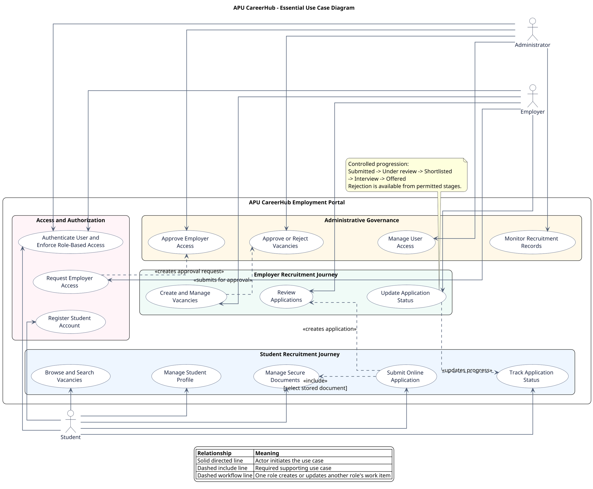

# APU CareerHub Feature and Use Case Prioritisation Guide

## 1. Purpose of This Document

This document explains the implemented features and use cases of APU CareerHub and identifies which use cases should appear in the final UML use case diagram. The prioritisation is based on:

- the project aim and objectives stated in Chapter 1;
- the functional scope promised in the report;
- the completed Next.js, Firebase Authentication, Firestore and Cloud Storage implementation; and
- the need to keep the final diagram readable and focused on user goals rather than low-level implementation details.

The recommended diagram uses only the three agreed primary actors:

1. **Student**
2. **Employer**
3. **Administrator**

A separate Public or Visitor actor is intentionally excluded. Public vacancy browsing is treated as part of the Student journey because the portal is specifically designed for APU students, while Student is the role that continues into application submission and tracking.

---

## 2. Project Aim and Objectives From the Report

### 2.1 Project Aim

The project aims to design, develop and implement a centralized web-based employment portal for Asia Pacific University that improves the efficiency, transparency and accessibility of on-campus recruitment for student applicants and administrative stakeholders.

### 2.2 Project Objectives

The report defines the following objectives:

1. **Objective 1 - Requirements investigation:** Examine inefficiencies, information fragmentation and user needs in the existing APU on-campus recruitment process through survey data collection and analysis.
2. **Objective 2 - System development:** Design and develop a centralized web-based employment portal that supports vacancy posting, online application submission, secure document management and application tracking for APU on-campus employment.
3. **Objective 3 - System evaluation:** Test the usability, functional effectiveness and performance of the portal through system testing and User Acceptance Testing.

### 2.3 Effect of the Objectives on the Use Case Diagram

The use case diagram should mainly demonstrate **Objective 2**, because it describes the functionality delivered by the system.

- Objective 1 concerns research and requirements collection. Surveys and data analysis are research activities, not interactions with the completed APU CareerHub system, so they should not appear as use cases.
- Objective 2 defines the core system promise and must provide the main structure of the diagram.
- Objective 3 concerns testing and evaluation. Unit testing, system testing and UAT belong in Chapter 5 and should not appear as production-system use cases.

---

## 3. System Actors

### 3.1 Student

The Student is an APU student who uses the portal to discover approved on-campus vacancies, maintain application information and documents, submit applications and follow recruitment progress.

### 3.2 Employer

The Employer is an authorized representative of an APU department, such as APU Library, Student Affairs or the IT Department. The Employer creates vacancies, submits them for administrative approval, reviews applications belonging to its department and updates applicant progress.

Employer self-registration creates a pending account request. Employer portal access is unavailable until an Administrator approves the request.

### 3.3 Administrator

The Administrator governs the portal. This actor approves Employer access, controls user-account availability, reviews vacancy submissions, monitors applications and recruitment records, and inspects important system activity.

The system may contain a primary Administrator with additional authority to create other Administrator accounts, but this distinction does not need to become a fourth actor in the main diagram.

---

## 4. Complete Implemented Feature Catalogue

This section documents the complete implemented feature set. The **Diagram treatment** column indicates whether a feature should appear independently in the final use case diagram.

### 4.1 Shared Access and Account Features

| Feature or use case | Implemented behaviour | Diagram treatment |
|---|---|---|
| Register Student Account | Creates a Firebase Authentication account, active Student profile and trusted Student role before opening the Student portal. | **Essential independent use case** because Student onboarding is part of the promised scope. |
| Request Employer Access | Creates a pending Employer profile that cannot enter the Employer portal until administrative approval. | **Essential independent use case** because it explains controlled Employer access. |
| Authenticate User | Verifies email and password, the active Firestore profile, trusted role claim and Employer approval before creating a secure session. | **Essential shared use case** for all three roles. |
| Enforce Role-Based Access | Redirects authenticated users to the correct portal and blocks unauthorized pages and actions. | Show as part of **Authenticate User**, not as a large independent actor goal. |
| Reset Forgotten Password | Uses Firebase Authentication to send a password-reset email. | Generic authentication feature; omit from the main diagram. |
| Change Password | Re-authenticates the user, validates a strong password and ends the session after the change. | Generic account-security feature; omit from the main diagram. |
| Update Account Settings | Allows a signed-in user to update their name and phone number while keeping the login email and role protected. | Generic account feature; omit from the main diagram. |
| Sign Out | Clears the server session and signs the browser out of Firebase. | Generic behaviour; omit from the main diagram. |
| Help and Support | Displays role-specific support guidance and opens an email channel. | Supporting convenience feature; omit from the main diagram. |

### 4.2 Student Features

| Feature or use case | Implemented behaviour | Diagram treatment |
|---|---|---|
| View Student Dashboard | Displays active application, progressing-application and available-vacancy counts together with recent activity and recommended vacancies. | Dashboard is an interface entry point rather than a project objective; omit as a separate use case. |
| Browse and Search Vacancies | Displays only published vacancies and supports keyword, category and employment-type filtering. | **Essential independent use case** because centralized vacancy discovery addresses information fragmentation. |
| View Vacancy Details | Displays the vacancy description, responsibilities, requirements, useful skills, location, compensation, work arrangement, hours and deadline. | Include within **Browse and Search Vacancies** rather than showing another oval. |
| Manage Student Profile | Maintains Student ID, programme, phone, introduction, skills and availability for future applications. | **Essential supporting use case** because the report explicitly promises profile maintenance. |
| Manage Profile Picture | Uploads, changes or removes an optional protected image after validating file type, signature and size. | Optional presentation feature; omit from the main diagram. |
| Manage Secure Documents | Uploads and stores PDF, DOC and DOCX documents in owner-scoped Cloud Storage paths with Firestore metadata. | **Essential independent use case** because secure document management is stated directly in Objective 2. |
| Rename or Delete Documents | Renames display names while preserving extensions and deletes only documents that are not attached to submitted applications. | Supporting operations within **Manage Secure Documents**; do not show separately. |
| Submit Online Application | Collects a cover letter, selected supporting document and confirmation before creating the application. | **Essential independent use case** because online application submission is stated directly in Objective 2. |
| Validate Application | Verifies vacancy status, deadline, Student identity, document ownership, protected path and duplicate submission before saving. | Important system rule, but not a separate user goal. Explain it in a diagram note or use case description. |
| Track Application Status | Separates active and previous applications and displays the ordered status history, Employer messages, vacancy summary and submitted document. | **Essential independent use case** because transparent application tracking is stated directly in Objective 2. |

### 4.3 Employer Features

| Feature or use case | Implemented behaviour | Diagram treatment |
|---|---|---|
| View Employer Dashboard | Displays active-vacancy, total-applicant and awaiting-review metrics together with recent applicants and vacancy performance. | Dashboard is an interface summary; omit as a separate use case. |
| Maintain Department Profile | Updates the contact person, phone number, department and description shown for the Employer. | Supporting account feature; omit from the main diagram. |
| Create and Manage Vacancies | Creates vacancy drafts, edits drafts or rejected submissions, views owned vacancies and closes published vacancies. | **Essential independent use case** because vacancy posting and management are central project promises. |
| Submit Vacancy for Approval | Validates the full vacancy and changes its status to pending approval for administrative review. | Represent as an included part of **Create and Manage Vacancies**, not as a separate actor-level oval. |
| Review Applications | Lists and filters applications for vacancies owned by the Employer and displays the applicant profile and cover letter. | **Essential independent use case** because applicant review is promised in the project scope. |
| Review Protected Document | Permits the owning Employer to download only the document selected for an application belonging to that Employer. | Include within **Review Applications** rather than showing separately. |
| Update Application Status | Moves an application through controlled stages and may store a Student-visible message and a private review note. | **Essential independent use case** because shortlisting and status updates are promised in the scope. |
| Record Status History | Stores each status transition as an immutable history entry and records an audit event. | Internal supporting behaviour; show through a note if needed, not as a separate use case. |

### 4.4 Administrator Features

| Feature or use case | Implemented behaviour | Diagram treatment |
|---|---|---|
| View Administration Dashboard | Displays published jobs, applications, pending approvals and stored-record totals using live data. | Dashboard and live indicator are interface features; omit as independent use cases. |
| Approve Employer Access | Verifies a pending Employer request, assigns the trusted Employer claim and activates approved portal access. | **Essential independent use case** because the Employer journey cannot operate without controlled approval. |
| Manage User Access | Displays Students, Employers and Administrators and allows authorized activation or deactivation. | **Essential governance use case** representing role-based administrative control. |
| Create Administrator Account | Allows only the primary Administrator to create another Administrator with a temporary password. | Specialized governance feature; omit from the main diagram and mention in the detailed feature description. |
| Approve or Reject Vacancies | Reviews pending vacancy submissions and either publishes them or returns them to the Employer as rejected. | **Essential independent use case** because it completes the authorized vacancy-posting workflow. |
| Close or Archive Vacancy Records | Closes published vacancies and archives eligible records. | Supporting actions within administrative vacancy management; do not show separately. |
| Monitor Recruitment Records | Searches and filters system-wide applications by Student, vacancy, department and status. | **Essential independent use case** because administrative recruitment-record management is promised in the scope. |
| Review Audit Logs | Shows important authentication, user, vacancy, application and document events. | Important security support, but not a direct Objective 2 promise; omit from the main diagram. |

---

## 5. Objective-to-Use-Case Traceability

| Report promise | Essential use cases that demonstrate it |
|---|---|
| Centralized access to on-campus vacancies | Authenticate User; Browse and Search Vacancies |
| Vacancy posting and management | Create and Manage Vacancies; Approve or Reject Vacancies |
| Online application submission | Submit Online Application |
| Secure document management | Manage Secure Documents; Submit Online Application; Review Applications |
| Application tracking and transparency | Update Application Status; Track Application Status |
| Applicant review and shortlisting | Review Applications; Update Application Status |
| Recruitment-record management | Monitor Recruitment Records |
| Role-based access control | Authenticate User; Approve Employer Access; Manage User Access |
| Student account and profile management | Register Student Account; Manage Student Profile |
| Controlled Employer onboarding | Request Employer Access; Approve Employer Access |

---

## 6. Recommended Essential Use Cases for the Final Diagram

The final use case diagram should contain the following fifteen use cases, ordered by their importance to the project objectives and recruitment workflow.

### 6.1 Highest Priority: Direct Objective 2 Commitments

1. **Browse and Search Vacancies** - Student
2. **Create and Manage Vacancies** - Employer
3. **Approve or Reject Vacancies** - Administrator
4. **Manage Secure Documents** - Student
5. **Submit Online Application** - Student
6. **Review Applications** - Employer
7. **Update Application Status** - Employer
8. **Track Application Status** - Student

These eight use cases directly demonstrate centralized vacancy discovery, vacancy posting, secure documents, online applications and transparent application tracking.

### 6.2 Medium Priority: Necessary Supporting Scope

9. **Register Student Account** - Student
10. **Request Employer Access** - Employer
11. **Authenticate User** - Student, Employer and Administrator
12. **Manage Student Profile** - Student
13. **Approve Employer Access** - Administrator
14. **Manage User Access** - Administrator
15. **Monitor Recruitment Records** - Administrator

These use cases explain how authorized users enter and govern the recruitment process without distracting from the main employment workflow.

---

## 7. Features That Should Not Appear as Separate Use Cases

The following features are implemented and may be explained in the surrounding report, but showing each one as an oval would make the diagram crowded without improving its explanation of the project objectives:

- landing page;
- role dashboards and summary cards;
- live-data indicator;
- recommendations and profile-completion percentage;
- view vacancy details as a separate oval;
- search filters as separate use cases;
- profile-picture upload, change and removal;
- document download, rename and deletion as separate use cases;
- cover-letter entry as a separate use case;
- duplicate-application prevention;
- deadline and field validation;
- Firebase credential verification;
- secure cookie creation;
- session termination and sign-out;
- forgot-password and change-password interfaces;
- general account settings;
- department-profile maintenance;
- viewing or downloading an applicant document as a separate use case;
- Student messages and private review notes as separate use cases;
- status-history creation;
- applicant-count updates;
- audit-log creation and viewing;
- close and archive vacancy as separate use cases;
- Administrator-account creation;
- help and support pages; and
- low-level database, Storage and security-rule operations.

These behaviours should be expressed through `<<include>>` relationships, notes, constraints or written use case descriptions where necessary.

---

## 8. Recommended Relationships in the Diagram

| Source use case | Relationship | Target use case | Meaning |
|---|---|---|---|
| Authenticate User | `<<include>>` | Enforce Role-Based Access | Successful login always determines the correct authorized portal. Role enforcement may be written inside the Authenticate User use case instead of becoming another oval. |
| Request Employer Access | workflow dependency | Approve Employer Access | An Employer request creates pending work for the Administrator. |
| Create and Manage Vacancies | `<<include>>` | Approve or Reject Vacancies | A submitted vacancy must receive an administrative decision before publication. |
| Submit Online Application | `<<include>>` | Manage Secure Documents | The Student must select an owned stored document when applying. |
| Submit Online Application | workflow dependency | Review Applications | A successful Student submission creates an Employer review record. |
| Update Application Status | workflow dependency | Track Application Status | Employer decisions update the Student-visible progress timeline. |

---

## 9. Simplified Recruitment Workflow

1. A Student registers and signs in.
2. An Employer requests access and waits for Administrator approval.
3. The Administrator approves the Employer account.
4. The Employer creates a vacancy and submits it for approval.
5. The Administrator approves or rejects the vacancy.
6. An approved vacancy becomes available through Student vacancy discovery.
7. The Student maintains a profile and secure supporting documents.
8. The Student submits an online application using a selected document.
9. The Employer reviews the application and updates its status.
10. The Student views the updated application progress and messages.
11. The Administrator monitors users, vacancies and recruitment records across the portal.

This sequence fully communicates the operation of APU CareerHub without exposing unnecessary technical implementation details.

---

## 10. Recommended Final PlantUML Source

The following reduced diagram is recommended for Chapter 4. It contains only the objective-linked and workflow-critical use cases.

---

## 11. Final Recommendation

Use the simplified fifteen-use-case version as the main Chapter 4 figure. It demonstrates every major capability promised in the project objectives while keeping the diagram readable.

The earlier detailed diagram remains useful as a technical appendix or internal system reference, but it is too detailed for the primary report figure because it includes interface controls, validation rules and implementation-level supporting behaviour.

Recommended caption:

*Figure 4.X: Use Case Diagram for APU CareerHub*

